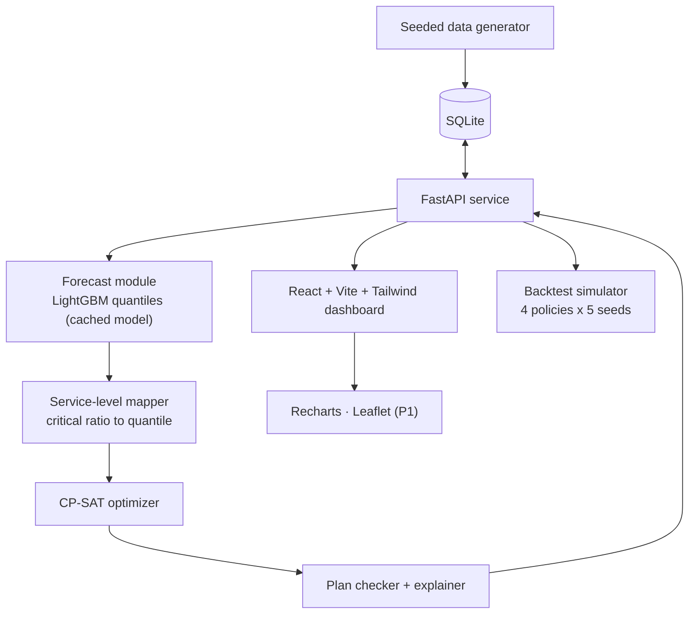

# VitaranIQ — Product Requirements Document

**Triwizathon · Problem Statement 2: Distribution Intelligence & Inventory Optimization Engine**
**Team:** Innovate-x · **Project:** VitaranIQ
**Team Lead:** Devendra Nimbalkar · **Members:** Manish Patil, Pranav Yadav, Om Lad · **Version:** 2.0 (Round 1 submission)

---

## 1. Executive Summary

FMCG companies ship products from a few warehouses to many stores. Demand varies by store and day, stock sits in batches that expire, and every truck has a cost. The result is stockouts in one place and expired stock in another.

**VitaranIQ** converts inventory, sales history and network constraints into an executable weekly dispatch plan: *which SKU, how many units, from which warehouse batch, to which store, on which truck.*

It is a four-stage pipeline:

1. **Forecast.** A LightGBM quantile model predicts each store–SKU's demand over the next 9 days (7-day review period + 2-day maximum lead time) at P50, P70, P80 and P90.
2. **Optimize.** An OR-Tools CP-SAT integer program allocates warehouse batches to stores under stock, truck, store-capacity, lead-time and shelf-life (FEFO) constraints. The service level for each SKU is chosen from a newsvendor critical ratio instead of a fixed buffer.
3. **Prove.** A 28-day simulator replays held-out demand over 5 random seeds. It compares four policies on identical conditions: two heuristic baselines, the optimizer with a moving-average forecast, and the full VitaranIQ system. This isolates what the ML forecast adds on top of the optimizer.
4. **Explain.** Every shipment line carries reason codes computed from solver and forecast numbers, and an independent plan-checker validates every hard constraint before a plan is shown.

**Demo network:** 4 warehouses, 25 stores, 12 SKUs. That is 300 store–SKU series and 24 months of seeded synthetic daily sales (about 219,000 rows).

**Headline targets (measured on the demo network, mean of 5 seeds, vs the strongest baseline):** stockout rate −25%, wastage −25%, fill rate ≥ 95%, cost per unit delivered no higher than baseline, plan generated in ≤ 15 s. §8 also defines a minimum acceptable floor for each target. The dashboard shows observed values, including misses.

---

## 2. Problem Statement

### 2.1 The problem
Weekly distribution planning is typically done with spreadsheets, last-week-sales rules and planner judgement. The decision space grows quickly. Our demo network has 25 stores × 12 SKUs = 300 store–SKU decisions per cycle, each with up to 4 candidate warehouses, several batches with different expiry dates, and truck-rounding effects. Manual review cannot optimize this.

| Failure | Mechanism | Consequence |
|---|---|---|
| Stockouts | Static averages miss weekday, festival and promo effects | Lost sales and margin |
| Wastage | Short-life stock goes to slow-selling stores, or newer batches ship before older ones | Expired inventory written off |
| Transport inefficiency | Dispatch ignores truck fill, lane cost and second-warehouse options | Part-empty trucks, higher ₹ per unit |
| Unprioritized scarcity | Short stock is split by habit, not by margin at risk | Highest-value demand goes unserved |

### 2.2 Why forecasting and optimization are both needed
- **Forecasting alone** says what each store will probably sell. It does not decide who gets scarce stock, which batch ships, or how trucks are filled.
- **Optimization alone** with last-week sales as the demand input inherits the weekday, promo and festival blind spots of static averages.
- **Combined:** the forecast provides calibrated demand quantiles, and the optimizer converts them into feasible, cost-minimizing decisions. The ablation in §5 (F-08) measures the contribution of each part.

### 2.3 Illustrative impact (arithmetic, not a measured claim)
For a distributor with ₹100 Cr annual sales, a 1-percentage-point fill-rate gain recovers about ₹1 Cr of sales. At an assumed 12% gross margin, that is about ₹12 L of margin per year. Wastage reductions add savings on top, because expired stock is written off at cost.

### 2.4 Goals and non-goals
**Goals**
- Produce feasible, cost-aware dispatch recommendations in ≤ 15 s.
- Quantify improvement against baselines with a reproducible backtest.
- Explain every recommendation with computed evidence.

**Non-goals (this build)**
- ERP/WMS integration, road-level vehicle routing (VRP), supplier procurement and purchase orders, and multi-echelon planning from manufacturing plants.

---

## 3. User Personas

Persona context is assumed from the problem statement.

| Persona | Today's workflow and pain | Needs | Success looks like |
|---|---|---|---|
| **Priya, Supply-Chain Planner** (primary) | Builds the weekly dispatch plan for 25 stores in Excel from last week's sales. Gets store escalations about stockouts and expiry. | A plan she can trust and approve in minutes. Evidence for every line. | Approves or edits a plan in under 10 minutes. Fewer store escalations. |
| **Rahul, Regional Distribution Manager** | Owns service level, cost and wastage targets. Has no clean way to compare planning methods. | Measured proof that the system beats the current method. | Reads KPI deltas versus baselines with the policy definitions. |
| **Sunita, Warehouse Manager** | Receives dispatch instructions late and in inconsistent format. Expiring batches are noticed late. | Clear FEFO pick instructions per truck. | One consistent, feasible pick list per truck. |
| **Business Owner / Evaluator** | Decides whether to adopt the tool. | Stated assumptions, limits and proof. | Reads the assumptions page and the backtest page. |

---

## 4. Core User Journeys

**J1. Weekly dispatch planning (primary)**
1. Priya opens the dashboard. She sees KPI cards and a stockout/expiry risk heatmap (store × SKU).
2. She clicks *Generate Plan*. The system loads the cached forecast model, solves, runs the plan-checker and returns the plan in ≤ 15 s.
3. She reviews the shipment table (SKU, qty, from, to, batch, truck, ₹ cost, reason codes) and opens any line to see its evidence.
4. She exports the plan as CSV. (Per-warehouse pick lists and quantity overrides are P1.)

**J2. Prove it beats the current method**
1. Rahul opens *Baseline vs VitaranIQ* and selects the 28-day window.
2. He sees four policies side by side: B1, B2, Optimizer + moving average, and VitaranIQ. KPIs are shown as the mean with min–max over 5 seeds, plus a day-by-day chart.

**J3. Warehouse outage what-if**
1. Priya selects *Warehouse W2 unavailable*.
2. The system sets W2 stock to zero, re-optimizes and shows the delta against the base plan (extra transport ₹, change in fill rate, affected stores, unmet demand by SKU). Further scenarios (demand spike, fuel cost) are P1.

**J4. Explain a recommendation**
1. Priya opens a line, e.g. *Biscuit-250g: 120 units, W1 → Store 14*.
2. The panel shows the relevant forecast quantile against on-hand stock and days of cover, the batch expiry, the lane cost, and the reason codes. (P1 adds the cost of the next-best source.)

**Edge paths handled in P0**
- *Stock insufficient:* the plan records unmet demand per store–SKU and prioritizes by margin at risk.
- *Solver timeout:* the best feasible solution found is returned, flagged with its optimality gap.
- *Invalid or missing input data:* validation rejects the run with a specific message (see NFR-03).

---

## 5. Functional Requirements

**Priorities:** P0 = required for the MVP demo · P1 = added once P0 is stable · P2 = optional.
Effort is in person-hours. P0 totals 95 h against an effective team capacity of about 130 h (4 members × ~32 productive hours of a 48-hour window). The remaining ~35 h funds P1 items and integration slack.

### 5.1 P0 — MVP (95 h)

| ID | Requirement | Acceptance criteria | Effort |
|---|---|---|---|
| F-01 | **Seeded synthetic data generator.** Warehouses, stores, SKUs, 24 months of daily sales (weekday, seasonality, festival and promo effects, negative-binomial noise), batch-level warehouse stock with expiry, lane distances, truck specs, weekly scheduled warehouse inbound. | Same seed gives identical data. Full regeneration takes ≤ 60 s. Data card lists every constant. | 6 |
| F-02 | **Demand forecast.** One global LightGBM model per quantile (P50, P70, P80, P90). The target is cumulative demand over the next 9 days per store–SKU. Features: lags, rolling means, day of week, month, holiday/festival and promo calendar (known in advance), SKU and store attributes. Train once per dataset version and cache the model. | Time-ordered split with a 9-day gap between train and test (no leakage). Reports WAPE, bias and quantile coverage. Targets in §8.2. | 14 |
| F-03 | **Service-level selection.** For each SKU, the critical ratio is `CR = margin / (margin + overage_cost)`, where overage cost = unit cost × write-off factor *w* (*w* = 1.0 if shelf life ≤ 14 days, 0.3 if ≤ 90 days, otherwise 0.1; constants in the data card). CR is mapped to the nearest trained quantile (P50/P70/P80/P90; CR below 0.5 uses P50). `target_q[s,p]` is that quantile of 9-day demand. | Mapping table shown in the app. Short-life, low-margin SKUs get lower quantiles. High-margin staples get P90. | 3 |
| F-04 | **Optimization engine** (OR-Tools CP-SAT, all variables integer, costs scaled to paise). Formulation in §6.5. | Always returns a plan (all-zero shipments plus unmet demand is a valid fallback). Solve ≤ 10 s on the demo network. Time limit 8 s with best-feasible result and optimality gap reported. | 16 |
| F-05 | **Shelf-life and FEFO.** A batch ships only if remaining life on arrival ≥ SKU minimum. Older eligible batches ship first. Units from batches with limited life are capped by expected sell-through within that life. | Plan-checker finds no expired or ineligible shipments and no FEFO inversions (§6.6). | 8 |
| F-06 | **Independent plan-checker.** Re-computes every hard constraint from plan lines only, without reusing solver variables (§6.6). | 0 violations on 20 random seeds. A deliberately corrupted plan is detected in a unit test. | (in F-04/F-05) |
| F-07 | **Recommendation table.** Columns: SKU, from, to, batch, qty, truck, ₹ cost, priority, reason codes. Filter, sort, CSV export. | Every line has ≥ 1 reason code. CSV opens cleanly in Excel. | 6 |
| F-08 | **Explainability.** Rule-based reason codes with numeric evidence (§6.7). | 100% of lines explained. Displayed numbers equal solver/forecast output exactly. | 6 |
| F-09 | **Backtest simulator.** 28 held-out days, weekly re-planning (days 1, 8, 15, 22), 5 demand seeds and two supply scenarios (**normal**: scheduled warehouse inbound = 105% of mean demand; **scarcity**: 80%). Four policies: **B1** proportional to last-4-weeks sales from the nearest warehouse; **B2** reorder-up-to with fixed safety stock; **O-MA** the same optimizer driven by a 7-day moving-average forecast; **VitaranIQ** with the LightGBM quantiles. Simulator rules in §6.8. | All policies face identical demand and identical physical rules. All plans pass the same checker. Reports the KPIs defined in §8.1. | 14 |
| F-10 | **Dashboard.** KPI cards, risk heatmap, forecast vs actual chart per store–SKU, backtest comparison page. | Loads ≤ 2 s on demo data. | 14 |
| F-11 | **Assumptions and limitations page** (also the README). | Lists data sources, formulas, constants and limits (§11). | 4 |
| F-12 | **Warehouse-outage what-if.** Single scenario that zeroes one warehouse's stock and re-plans. | Result in ≤ 20 s with a delta table versus the base plan. | 4 |

### 5.2 P1 — added after P0 is stable (30 h)

| ID | Requirement | Acceptance criteria | Effort |
|---|---|---|---|
| F-13 | Additional what-if scenarios: regional demand spike, fuel-price change. | ≤ 20 s each, with a delta table. | 4 |
| F-14 | Map view of warehouse → store flows (Leaflet). | Click a flow to open its plan line. | 6 |
| F-15 | Planner overrides: edit quantity or force a source, then re-validate. | Infeasible edits are rejected with the violated constraint named. | 8 |
| F-16 | Counterfactual explanation: re-solve with the alternative source forced to report the next-best cost. | Shown for the top 20 lines by value. | 8 |
| F-17 | Per-warehouse FEFO pick lists (CSV or PDF). | One file per warehouse. | 4 |

### 5.3 P2 — optional
Inter-store rebalancing of near-expiry stock (F-18) · Optional LLM rewording of reason codes from computed numbers only, with a template fallback (F-19) · Forecast drift monitor (F-20) · Cost-vs-service Pareto slider (F-21) · PostgreSQL and login (F-22).

### 5.4 Non-functional requirements

| ID | Requirement |
|---|---|
| NFR-01 | **Determinism:** the same dataset seed, model version and inputs give the same plan. |
| NFR-02 | **Performance budget (plan generation):** input assembly ≤ 1 s, forecast inference ≤ 2 s, solve ≤ 8 s, checker and explainer ≤ 1 s, giving ≤ 12 s expected and ≤ 15 s hard target. |
| NFR-03 | **Input validation:** reject negative stock, expiry dates in the past, missing lane distances, and SKUs without volume or shelf life. Return a field-level error message. |
| NFR-04 | **Honest reporting:** no KPI value is hardcoded. All figures come from the simulator and are stamped with model version, seed list and date. |
| NFR-05 | **Test coverage:** unit tests for the checker, the FEFO logic and the simulator accounting. A reproducibility test regenerates the dataset and compares hashes. |

---

## 6. High-Level Architecture & Data Flow

### 6.1 Design principle
ML predicts demand. The optimizer decides. The checker verifies. An LLM is not in the decision path. The model is trained once per dataset version and cached, so plan generation does not retrain.

### 6.2 Component diagram



### 6.3 Data flow for `POST /plan`

| Step | Input | Process | Output |
|---|---|---|---|
| 1 | `as_of_date`, scenario | Load stock, in-transit, lanes, calendar. Validate (NFR-03). | Validated state snapshot |
| 2 | State and cached model | Predict 9-day cumulative demand at P50/P70/P80/P90 per store–SKU. | Forecast table (300 rows × 4 quantiles) |
| 3 | Forecast and margins | Compute critical ratio and select quantile. Compute `target_q`. | Target stock position per store–SKU |
| 4 | Targets, batches, lanes, truck specs | Build and solve the CP-SAT model (≤ 8 s). | Shipment quantities per `(w,s,p,b)`, truck counts, unmet demand |
| 5 | Optimizer output | Re-validate all hard constraints. Run the FEFO repair if needed. | Verified plan or a hard error |
| 6 | Verified plan and forecasts | Assign reason codes with evidence. | Plan lines with explanations |
| 7 | Plan lines | Persist to SQLite and return JSON. The UI renders the table, charts and KPIs. | Dashboard view, CSV |

### 6.4 Tech stack

| Layer | Choice | Why |
|---|---|---|
| Frontend | React + Vite + Tailwind, Recharts, Leaflet (P1) | Fast to build. Recharts covers the KPI and forecast charts. |
| Backend | **FastAPI (Python)** | One language for API, forecasting and optimization, which removes a Node↔Python bridge. |
| Forecasting | pandas, LightGBM (quantile objective), scikit-learn for baselines and metrics | Native quantile support. About 220k rows trains in well under a minute. |
| Optimization | Google OR-Tools CP-SAT | Free, handles integer shipment and truck variables. Quantities are integers, and costs and volumes are scaled to integers. |
| Storage | SQLite (P0), PostgreSQL (P2) | Zero setup. |
| Deployment | Docker Compose | One-command reproducible demo. |

### 6.5 Optimization formulation

**Sets:** warehouses *W*, stores *S*, SKUs *P*, batches *B(w,p)*. **Coverage window:** 9 days (7-day review + 2-day maximum lead time).

**Decision variables (integers)**
- `x[w,s,p,b] ≥ 0` units of batch *b* shipped from *w* to *s*
- `y[w,s] ≥ 0` trucks used on lane (*w*,*s*)
- `u[s,p] ≥ 0` unmet demand against `target_q`
- `e[s,p] ≥ 0` stock above `target_q`

**Objective (minimize ₹)**
```
Σ y[w,s] · (fixed_truck_cost + cost_per_km · km[w,s])          transport
+ Σ u[s,p] · margin[p] · (1 + criticality[p])                  lost-sales penalty
+ Σ e[s,p] · holding_cost[p]                                    excess stock
+ Σ x[w,s,p,b] · waste_coeff[b,s,p]                             expected wastage
+ Σ x[w,s,p,b] · ε · age_rank[b]                                FEFO tie-break
```
`waste_coeff[b,s,p] = unit_cost[p] × share of the shipment expected unsold at expiry`. That share is estimated from the store's quantile forecasts over the batch's remaining life (pro-rated from the 9-day forecast when life is shorter than 9 days).

`criticality[p]` ∈ {0, 0.25, 0.5} is set per SKU in the data card (staples 0.5). `safety[s,p] = target_q[s,p] − D_P50[s,p]` over the 9-day window, pro-rated for shorter lives.

**Model size:** about 3,600 integer shipment variables (4 × 25 × 12 × ~3 batches, fewer after eligibility filtering) plus 100 truck variables.

**Constraints**
1. **Warehouse stock:** `Σ_s x[w,s,p,b] ≤ stock[w,p,b]`
2. **Coverage:** `position[s,p] + u[s,p] ≥ target_q[s,p]`, where `position[s,p] = onhand + intransit + Σ x[·,s,p,·]`
3. **Excess definition:** `e[s,p] ≥ position[s,p] − target_q[s,p]`
4. **Truck volume:** `Σ_{p,b} vol[p] · x[w,s,p,b] ≤ truck_vol · y[w,s]`
5. **Fleet limit:** `Σ_s y[w,s] ≤ fleet[w]`
6. **Store capacity:** `Σ_p vol[p] · position[s,p] ≤ store_cap[s]`
7. **Shelf life on arrival:** `x[w,s,p,b] = 0` if `expiry[b] − (as_of + transit[w,s]) < min_life[p]`
8. **Sell-through cap:** for each store–SKU and each remaining-life level *L*, units from batches with remaining life ≤ *L*, plus on-hand stock expiring within *L*, must not exceed `D_P50(L) + safety`
9. **Lead time:** lanes with `transit > allowed_days[p]` are excluded

**Scarcity.** When stock is short, `u` carries the lost-sales penalty, so the solver serves the highest margin-at-risk first without a manual rule.

**Always feasible.** Shipping nothing with `u = target_q` satisfies every constraint, so the solver always has an incumbent solution when the time limit hits.

### 6.6 Plan-checker (independent validation)
Implemented as a separate module that reads only the output plan lines and the input snapshot. It checks:

1. Non-negative integer quantities.
2. Per-batch shipped quantity ≤ available stock.
3. Truck volume ≤ capacity and trucks per warehouse ≤ fleet.
4. Store capacity after delivery.
5. Remaining life on arrival ≥ SKU minimum.
6. Lead-time eligibility.
7. **FEFO invariant:** within a warehouse and SKU, if a newer batch ships on a lane, every older batch eligible on that lane is either fully shipped or exhausted. On a violation, a deterministic repair swaps quantities to restore FEFO order and re-checks.

### 6.7 Explainability design
Each plan line stores `{reason_code, evidence}` computed from solver and forecast numbers.

| Code | Trigger | Example evidence |
|---|---|---|
| `LOW_COVER` | Days of cover < lead time | "Cover 1.8 d; P90 demand 140, stock 30" |
| `EXPIRY_FIRST` | Oldest eligible batch used | "Batch B-221 expires in 9 d, shipped first" |
| `LOWEST_COST_SOURCE` | Chosen lane has the lowest ₹/unit among feasible lanes | "₹3.1/unit vs ₹4.4 from W3" |
| `CAPACITY_LIMITED` | Truck or store limit is binding | "Truck 96% full" |
| `SCARCE_PRIORITY` | Stock short, allocated by margin at risk | "Margin at risk ₹2.4 L, served first" |
| `NEXT_BEST` (P1) | Alternative source re-solved | "Next-best W3: +₹1,820" |

### 6.8 Backtest simulator rules
- **Day loop:** deliveries arrive after lane transit time. Held-out demand is realized. Store stock is sold FEFO. Unmet demand is lost (no backorders). Expired stock at stores and warehouses is written off at unit cost.
- **Planning:** a plan is generated on days 1, 8, 15 and 22 using only information available up to that day. The model is not retrained inside the window.
- **Warehouse supply:** each warehouse receives the same scheduled weekly inbound under every policy, so no policy benefits from extra supply.
- **Fairness:** all policies use the same trucks, costs, capacity rules and plan-checker.
- **Seeds:** 5 demand-noise seeds, identical across policies. Report mean and min–max.

### 6.9 Core data model
`warehouses(id, name, lat, lon, capacity_m3, fleet)` · `stores(id, name, lat, lon, region, storage_m3)` · `products(sku, name, category, unit_cost, price, volume_m3, shelf_life_days, min_life_days)` · `batches(batch_id, sku, warehouse_id, qty, expiry_date)` · `store_stock(store_id, sku, qty, expiry_date)` · `sales_daily(date, store_id, sku, units, promo_flag)` · `calendar(date, holiday_flag, festival_flag)` · `lanes(warehouse_id, store_id, km, transit_days)` · `plans(plan_id, created_at, scenario, model_version)` · `plan_lines(plan_id, sku, w, s, batch, qty, truck, cost, reason_codes)` · `backtest_runs(run_id, policy, seed, kpis_json)`

### 6.10 API surface

| Endpoint | Purpose |
|---|---|
| `GET /health` | Service and model status |
| `POST /data/generate` | Create or reset the seeded dataset |
| `POST /forecast/train` | Train and cache model; returns WAPE, bias, coverage |
| `GET /forecast/accuracy` | Stored accuracy metrics by store and SKU |
| `POST /plan` | Forecast → optimize → check → explain |
| `GET /plan/{id}/lines` | Plan lines with reasons |
| `GET /plan/{id}/export` | CSV (P0), pick lists (P1) |
| `POST /backtest` | Run the 4-policy comparison |
| `POST /whatif` | Apply scenario and re-plan |

**Example `POST /plan` response (abridged)**
```json
{
  "plan_id": "p_0001",
  "model_version": "lgbm_q_2026-11-02",
  "solver": {"status": "OPTIMAL", "gap_pct": 0.0, "time_s": 5.2},
  "checker": {"violations": 0},
  "lines": [
    {"sku": "BISC-250", "from": "W1", "to": "S14", "batch": "B-221", "qty": 120,
     "trucks_on_lane": 1, "line_cost_inr": 3720,
     "reason_codes": [
       {"code": "LOW_COVER", "evidence": {"cover_days": 1.8, "p90_demand": 140, "stock": 30}},
       {"code": "EXPIRY_FIRST", "evidence": {"expires_in_days": 9}}]}
  ],
  "unmet": [{"store": "S07", "sku": "MILK-1L", "units": 35, "reason": "STOCK_SHORT"}]
}
```

---

## 7. Innovation & Differentiation

| Differentiator | Why it is not an off-the-shelf approach |
|---|---|
| **Newsvendor-based service levels** | Each SKU's forecast quantile comes from its own margin-versus-overage ratio, not a flat safety-stock rule. Perishable low-margin SKUs get less buffer. High-margin staples get more. |
| **Quantile forecasts feed the optimizer** | Uncertainty enters the allocation decision directly. Window-level quantile targets avoid the error of summing daily P90s. |
| **Batch-level, shelf-life-aware allocation** | Decisions are made per batch with arrival-date eligibility, FEFO and sell-through caps, so expiry is handled in the plan itself. |
| **Ablation that isolates the AI contribution** | The O-MA versus VitaranIQ comparison measures what the ML forecast adds over the same optimizer, instead of claiming a combined gain. |
| **Independent plan-checker with FEFO repair** | Infeasible plans cannot reach the user. The checker uses a separate code path from the solver. |
| **Margin-aware scarcity handling** | Shortages are allocated by margin at risk through the objective. |
| **Disruption re-planning** | Warehouse outage re-optimization reports the cost and service impact in seconds. |

**Typical solution vs VitaranIQ**

| Aspect | Typical hackathon solution | VitaranIQ |
|---|---|---|
| Demand | Moving average or one point forecast | Quantile forecasts (P50–P90) with a measured gain over a moving average |
| Allocation | Proportional split or reorder-point rule | Integer program with truck, store-capacity and lead-time constraints |
| Expiry | Ignored, or a single shelf-life flag | Batch-level eligibility, FEFO and sell-through caps |
| Proof | Dashboard screenshots | 4-policy, 5-seed backtest with an ablation |
| Trust | Free-text explanation | Computed reason codes plus an independent checker |

**Moat and defensibility (product hypotheses beyond the hackathon build)**
- **Constraint library:** batch, FEFO, truck and store rules are encoded and unit-tested, which a generic forecasting tool does not provide.
- **Per-customer calibration:** quantile coverage and critical ratios are tuned on each customer's own sales and margins, and improve with history.
- **Benchmark harness:** the reproducible backtest lets a prospect test the method on its own history before adopting it.
- **Audit trail:** accumulated plan history and reason codes raise the cost of switching away.

---

## 8. Success Metrics (KPIs)

All values are measured on the seeded demo network and displayed in-app with seeds and model version (NFR-04). Each metric has a **target** and a **minimum acceptable floor**. Falling below a floor is reported as a failure.

### 8.1 Business impact (VitaranIQ vs the strongest baseline; mean of 5 seeds; normal-supply scenario unless stated)

| Metric | Definition | Target | Floor |
|---|---|---|---|
| Stockout rate | % of store–SKU–days ending with zero stock and unmet demand | −25% relative | −10% |
| Fill rate | Units sold ÷ units demanded, in the normal-supply scenario (warehouse supply ≥ 105% of demand) | ≥ 95% | ≥ 90% |
| Wastage | ₹ of stock expired at stores and warehouses (units × unit cost) | −25% relative | −10% |
| Cost per unit delivered | Transport ₹ ÷ units delivered | ≤ baseline | ≤ baseline + 5% |
| Average truck fill | Loaded volume ÷ truck capacity | ≥ 80% | ≥ 70% |
| AI contribution (ablation) | VitaranIQ vs O-MA on total cost (transport + lost margin + wastage) | ≥ 5% lower | Not worse than O-MA |
| Margin-weighted fill rate, scarcity scenario | Margin of units sold ÷ margin of units demanded, with inbound at 80% of demand | ≥ +5 percentage points vs B1 | At least equal to B1 |

### 8.2 Forecast quality (time-ordered holdout, 9-day window per store–SKU)

| Metric | Target | Floor |
|---|---|---|
| WAPE | ≤ 20% | ≤ 25% |
| WAPE improvement vs 7-day moving average | ≥ 15% relative | ≥ 5% |
| P90 coverage | 88–92% | 85–95% |
| Bias | within ±5% | within ±10% |

### 8.3 System performance and reliability

| Metric | Target |
|---|---|
| End-to-end plan generation (4 × 25 × 12) | ≤ 15 s |
| Solver time | ≤ 8 s limit, ≤ 10 s with overhead |
| What-if re-optimization | ≤ 20 s |
| Dashboard load | ≤ 2 s |
| Plan-checker violations | 0 across 20 random seeds |
| Plan lines with reason codes | 100% |

### 8.4 Usability

| Metric | Target |
|---|---|
| Clicks from dashboard to exported plan | ≤ 4 |
| Demo path completion without errors | 100% over 5 dry runs |

### 8.5 Traceability: problem → feature → metric

| Problem | Feature | KPI |
|---|---|---|
| Stockouts | F-02, F-03, F-04 | Stockout rate, fill rate |
| Wastage | F-05, F-06 | Wastage ₹ |
| Transport inefficiency | F-04 (truck variables) | Cost per unit delivered, truck fill |
| Unprioritized scarcity | F-04 (lost-sales penalty), F-09 (scarcity scenario) | Margin-weighted fill rate, scarcity scenario |
| Lack of trust and proof | F-08, F-09, F-12 | 100% explained, reproducible backtest |

---

## 9. Build Plan

Sized for a 48-hour build with 4 members. A 24-hour fallback is given below.

**Roles**
- **Devendra Nimbalkar (Lead): Backend and integration.** API contract, FastAPI, SQLite, integration, end-to-end testing, demo coordination.
- **Manish Patil: Frontend.** React dashboard, charts, plan table, CSV, API integration.
- **Pranav Yadav: Data and forecasting.** Generator, validation, quantile model, metrics, moving-average baseline.
- **Om Lad: Optimization.** CP-SAT model, FEFO logic, plan-checker, simulator policies.

| Phase | Hours | Work | Owner |
|---|---|---|---|
| 1 | 0–3 | Freeze scope, schema, API contract, acceptance tests | All, Devendra leads |
| 1 | 0–6 | Seeded generator, data card, sample CSVs | Pranav + Om |
| 2 | 3–10 | FastAPI skeleton, SQLite, mocked endpoints | Devendra |
| 2 | 3–10 | Dashboard layout on mocked responses | Manish |
| 3 | 6–16 | Moving-average baseline, quantile model, holdout metrics | Pranav |
| 3 | 8–20 | Optimizer: stock, truck, store capacity, unmet demand | Om |
| 4 | 16–24 | FEFO and shelf-life, plan-checker, reason codes | Om + Devendra |
| 4 | 16–26 | Real endpoints, recommendation table, KPI cards, charts | Manish + Devendra |
| 5 | 22–30 | Simulator, four policies, 5 seeds | Pranav + Om |
| 5 | 26–34 | Outage what-if, CSV export, backtest page | Manish + Devendra |
| 6 | 32–40 | Integration, constraint tests, bug fixes | All |
| 7 | 40–44 | Performance checks, reproducibility, failure-state tests | All |
| 8 | 44–48 | README, assumptions page, demo script, dry runs | All |

**Feasibility gates (go/no-go checks):**
- **Hour 6:** the generator produces the full-size dataset and the hash test passes.
- **Hour 16:** the quantile model is compared with the moving average on the holdout, and WAPE is reported.
- **Hour 24:** forecast → optimizer → checker runs end to end on the full network in ≤ 15 s.
- **Hour 30:** cut-line decision on the remaining P0 and P1 items.

**24-hour fallback:** keep F-01 to F-08, the simulator with B1 and VitaranIQ only (two policies, 1 seed), a basic dashboard and CSV. Defer the O-MA ablation, the what-if scenario, the map, overrides and counterfactuals. If still behind, simplify model training before removing any hard-constraint validation.

**Cut-line (48 h):** if behind at hour 30, drop in this order: map, counterfactuals, overrides, pick lists. Never bypass the plan-checker or hardcode KPI values.

---

## 10. Risks & Mitigations

| Risk | Likelihood | Impact | Mitigation |
|---|---|---|---|
| CP-SAT too slow at demo scale | Medium | High | 8 s time limit with best-feasible result. Zero-shipment plan guarantees an incumbent. Develop on a small seed, then verify the full network by hour 24. |
| ML shows little gain over moving average on smooth synthetic data | Medium | Medium | Generator includes promos and festivals that a moving average cannot anticipate. Promo calendar is a known-future feature. If the gain is small, report it, since the optimizer's contribution is still measured by B1/B2 vs O-MA. |
| Forecast leakage inflates accuracy | Medium | High | Time-ordered split, 9-day gap, no retraining inside the backtest window. |
| Backtest unfair to baselines | Medium | High | Same demand, trucks, costs and checker for all policies. Publish definitions. |
| Frontend–backend integration delay | Medium | Medium | Freeze the API contract in hour 3. Mock endpoints from hour 3. |
| Scope creep | High | High | P0/P1/P2 split with effort estimates and a cut-line. |
| Integer scaling errors in CP-SAT | Low | Medium | Unit tests compare solver cost with an independent cost calculation on the plan. |

---

## 11. Assumptions, Data Sources & Limitations

**Assumptions**
- The primary dataset is synthetic with a fixed seed. Demand has weekly patterns, seasonality, festival and promo spikes, and negative-binomial noise.
- Network: 4 warehouses and 25 stores in Maharashtra with simulated coordinates. Road distance is 1.3 × great-circle distance, a simulation assumption and not real route data.
- Lead time is 1–2 days per lane. Trucks are homogeneous (volume capacity, fixed cost plus per-km cost) with a per-warehouse fleet limit.
- Planning is weekly. Coverage window is 9 days. Backtest window is 28 days.
- Warehouses receive scheduled weekly inbound that is identical under every policy: 105% of mean demand in the normal scenario and 80% in the scarcity scenario.
- Lost sales are not backordered. Synthetic demand is uncensored, so the held-out demand used in the backtest is true demand.
- Costs, margins and shelf lives are realistic placeholders listed in the data card.

**Limitations**
- Results on synthetic data demonstrate the method. They do not guarantee real-world gains.
- Single-echelon (warehouse → store). No vehicle routing, supplier delays or returns.
- No substitution or cannibalization between SKUs.
- New SKUs and stores with no history use a category-average fallback with lower accuracy.
- Real data is censored by stockouts, so a deployment needs demand un-censoring.
- A real deployment needs ERP/WMS integration, data-quality checks and human approval.

**Data sources.** The seeded generator is primary, because public sales datasets lack batch expiry, truck and warehouse-stock fields. A public retail dataset (for example M5) may be used as a forecasting benchmark only, and its sales values are not mixed into the simulated logistics records.

---

## 12. Out of Scope
Procurement and purchase orders, route-level VRP, real-time telemetry, billing integration, mobile app, multi-currency and multi-language support.

---

## 13. Definition of Done (build arena)
- All P0 acceptance criteria pass.
- The backtest page shows measured KPIs for all four policies over 5 seeds, with targets and floors.
- The plan-checker reports zero violations on 20 random seeds.
- Seeded data regenerates identically (hash test).
- A one-command Docker start works on a clean machine.
- The 5-minute demo runs without error through J1 → J2 → J3 → J4.
